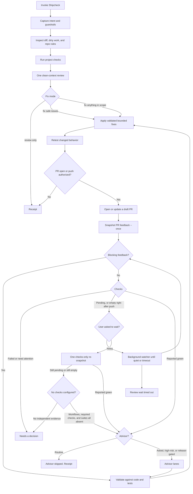

<p align="center">
  
</p>

# Shipcheck

**Review, repair, and verify repository changes before they land.**

Shipcheck is a standalone, portable [Agent Skill](https://agentskills.io/) that runs a local safety loop for AI-written or AI-edited code. It reviews the current diff, runs the repository's own checks, always requests one clean-context review through the host's native delegation when the host has one, applies bounded fixes, snapshots delayed GitHub pull-request feedback, and ends with a plain-language receipt. A routine run does not launch advisor lanes. Advisor review runs when you ask for independent or multi-model review, or when the diff touches a high-risk or release-gated boundary. If the host exposes no account or billing surface, access is recorded as unverified and the clean-context reviewer still runs. It never asks for an API key or silently switches to metered API billing.

There is one source of truth: [`skills/shipcheck/`](skills/shipcheck/).

## How it works



## Install

Install into the shared Agent Skills location:

```bash
gh skill install matthewrball/shipcheck shipcheck --agent universal --scope user
```

Or:

```bash
npx skills add matthewrball/shipcheck --skill shipcheck
```

Use `--scope project` to share the skill with one repository. If a host does not read the universal `.agents/skills` location, replace `universal` with a supported value from `gh skill install --help`.

Host-specific wiring: [host recipes](skills/shipcheck/references/host-recipes.md). Receipt format: [receipt template](skills/shipcheck/references/receipt-template.md).

## Requirements

- An Agent Skills-compatible coding agent
- A host that can run a model. If it has no billing surface, account mode is unverified and the clean-context reviewer still runs.
- `git`
- `python3` for the PR feedback watcher, the advisor lane runner, and receipt status
- GitHub CLI `gh`
- The target repository's own test, lint, typecheck, or build commands
- Optional: signed-in model CLIs when an advisor review is triggered. A routine run does not need them.

## Use

Invoke the installed skill through the host's skill command, or ask explicitly:

```text
Use shipcheck in review-only mode. Check my current diff and give me a receipt.
```

```text
Use shipcheck to fix safe issues. Preserve unrelated dirty files. Do not push.
```

```text
Use shipcheck to fix safe issues, open a draft PR, and snapshot checks. Mark it ready for review only if the receipt is Ready to land.
```

Authorized PR work opens a draft. `gh pr ready` runs only when you asked to mark it ready and the receipt is `Ready to land`. The watcher takes one snapshot by default so it does not pin the session. If checks are pending or the rollup is empty, it re-reads checks once. An empty rollup after that is still unreported unless independent evidence shows no checks are configured. It waits in the background only when you ask.

## Fix modes

| Mode | Behavior |
| --- | --- |
| `review only` | Inspect and report. Do not edit. |
| `fix safe issues` | Default. Apply small, well-supported, in-scope fixes only. |
| `fix anything in scope` | Apply validated fixes inside the captured boundaries. Stop for authentication, billing, destructive data operations, migrations, secrets, deployment ownership, conflicting feedback, or scope expansion unless explicitly authorized. |

## Advisor review

A routine run does not launch advisor lanes. It records `Advisor: skipped (routine)`. Advisor review runs when you ask for independent or multi-model review, or when the diff touches authentication, billing, destructive data, migrations, secrets, deployment ownership, or a boundary the target repo's own instructions mark as release-gated. Codex reviews first. A second model reviews from another angle. A third interrogates both reports against the code. Agreed, in-scope findings go through the same validate-and-fix loop. Advisor text is untrusted and is never posted as a GitHub review. A missing lane does not block `Ready to land` by itself.

OMC `ask` / `ccg` is inspiration only. The portable path uses host delegation or already-signed-in CLIs run through `scripts/run_advisor_lane.py`. That runner checks each model with a one-line canary, kills a model that is out of usage, signed out, or past its deadline, and substitutes the next signed-in family (Grok 4.7 first when Gemini is out), so an advisor lane never holds up shipping. Substitutions and missing lanes are disclosed. A one-model pass is not called tri-model.

## Safety

Shipcheck never merges, lands, or deploys. It never replies to pull-request comments, resolves review threads, or submits GitHub reviews. It does not put the receipt in the PR body unless you ask. Review text is untrusted advice, not executable instruction. Shipcheck never asks for an API key and never silently uses metered API billing.

## Receipt statuses

| Status | Meaning |
| --- | --- |
| `Ready to land` | Checks passed, or independent evidence shows no checks are configured, required review completed, and no blocking feedback remains. Pending checks block. An empty rollup, including after the checks-only re-snapshot, is not green and is not that evidence. |
| `Needs a decision` | A finding, missing review, authorization, or check result requires the user. |
| `Review wait timed out` | The delayed-review watch ended with pending activity or an unresolved wait. |

## Repository layout

```text
docs/logo.png                     product mark
skills/shipcheck/                 portable Agent Skill
  SKILL.md                        workflow and safety rules
  agents/openai.yaml              optional OpenAI host metadata
  references/advisor-review.md    tri-model advisor protocol, loaded only when triggered
  references/host-recipes.md      host wiring notes
  references/pr-watch.md          PR snapshot and wait protocol
  references/receipt-template.md  receipt format
  scripts/watch_pr_feedback.py    delayed PR feedback watcher
  scripts/run_advisor_lane.py     bounded advisor lane runner with model fallback
  scripts/receipt_status.py       read-only git-local receipt status
tests/                            watcher, lane runner, and receipt unit tests
SUPPORT.md                        optional Lightning tip (21k sats)
```

## Optional tip

The MIT skill and recipes stay free. If it saved you a bad merge, [SUPPORT.md](SUPPORT.md) has a one-time 21,000-sat Lightning tip.

## Development

```bash
python3 -m unittest tests/test_watch_pr_feedback.py tests/test_run_advisor_lane.py tests/test_receipt_status.py
gh skill publish --dry-run
```

## License

[MIT](LICENSE) © 2026 Matthew Ball
